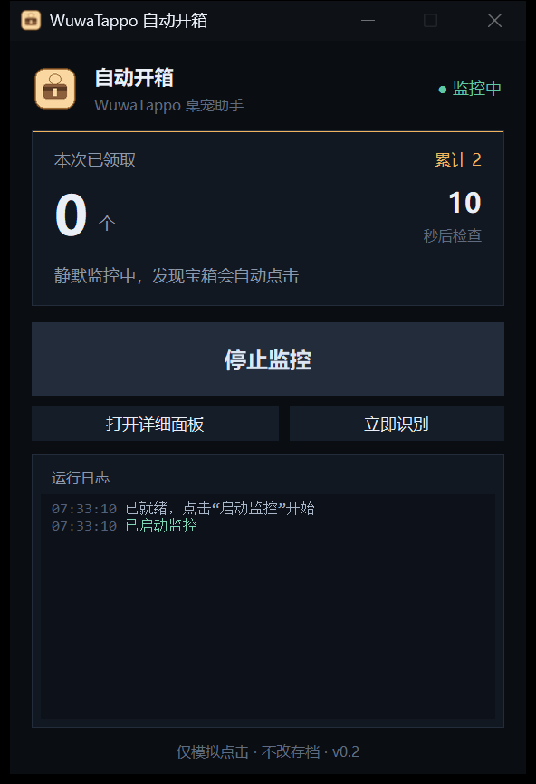

# WuwaTappo 自动开箱助手

[](https://github.com/Loveletter2/WuwaTappoAutoChest/actions/workflows/build.yml)
[](https://github.com/Loveletter2/WuwaTappoAutoChest/releases)
[](LICENSE)
[](https://github.com/Loveletter2/WuwaTappoAutoChest/releases)

一个 Windows 小工具：自动识别 **WuwaTappo 桌宠**旁边的宝箱气泡，确认坐标确实属于桌宠窗口后，模拟一次鼠标左键领取。

只做两件事：**看屏幕** + **点鼠标**。不读写存档、不改内存、不调用私有接口、不绕过服务端的宝箱冷却。



---

## 特性

- **静默监控**：点一次"启动监控"后可以最小化窗口，到点自动领取，不弹浏览器、不抢焦点。
- **两级安全锁**：识别阶段先按窗口过滤，点击前再用 `WindowFromPoint` 校验窗口类名与进程名，识别错了也点不到游戏或浏览器。
- **领取结果校验**：点击后复查图标是否消失，消失才计为成功；失败重试一次，再失败进入冷却。
- **迷你窗 + 详细面板**：日常只看迷你窗；需要倒计时圆环、检查间隔、识别预览时再打开浏览器面板。
- **零侵入**：单文件 exe，配置与日志都在 `%LOCALAPPDATA%\WuwaTappoAutoChest\`，卸载直接删目录。

---

## 快速开始

### 方式一：下载 exe（推荐）

1. 到 [Releases](../../releases) 下载最新的 `WuwaTappoAutoChest.exe`。
2. 双击运行，UAC 提示选"是"。
   - 桌宠以管理员权限运行，本工具也必须提权，否则模拟点击送不进桌宠窗口。
3. 出现迷你控制窗，状态为 **未启动**。
4. 点击 **启动监控**，确认弹出的系统提示后开始静默监控。

> 首次运行若被 SmartScreen 拦截：更多信息 → 仍要运行。

### 方式二：从源码运行

需要 Python 3.10+（官方安装包自带 tkinter）：

```bash
pip install -r requirements.txt
python autochest.py            # 迷你控制窗（默认）
python autochest.py --ui       # 直接打开浏览器详细面板
python autochest.py --tray     # 旧托盘模式（备用）
```

也可以双击 `run.bat`，它会自动查找 `pythonw` 并提权启动。

---

## 使用

1. 双击 `WuwaTappoAutoChest.exe`，UAC 选"是"。
2. 迷你窗默认 **未启动**，不会自动打开浏览器或开始点击。
3. 点 **启动监控** → 弹出系统置顶确认框：

   > 发现宝箱时，软件会短暂移动并点击鼠标（约 0.3 秒），请不要在游戏关键操作、拖拽文件时运行。

   选"是"才开始；每次启动都会提示，避免误触。
4. 运行中可用的操作：
   - **停止监控**：立即停止自动点击
   - **立即识别**：马上截屏识别一次
   - **打开详细面板**：按需在浏览器打开完整面板
5. 关闭迷你窗会停止监控并退出程序。

---

## 界面说明

### 迷你控制窗

| 区域 | 说明 |
|---|---|
| 本次已领取 / 累计 | 累计数量持久化在 `stats.json` |
| 下次检查 | 距离下一次扫描的秒数 |
| 状态 | 未启动 / 监控中 / 检查中 / 领取中 / 已暂停 / 冷却中 |
| 运行日志 | 最近 6 条记录，按 info / 成功 / 警告 / 错误着色 |
| 打开详细面板 | 可选，不点就不会打开浏览器 |

### 详细面板（可选）

- 420×680 深色卡片，在浏览器中居中显示
- 倒计时圆环、宝箱规则、检查间隔滑块（5–60 秒）
- 识别预览弹窗（绿框标注，可打开原图）
- 完整日志、清空、退出程序

---

## 识别与安全

1. 截取整个虚拟桌面（支持多显示器、150% 缩放）。
2. HSV 颜色阈值找"奶油色气泡"轮廓。
3. 过滤尺寸、长宽比、填充率，并要求气泡内有**成块的棕色宝箱图案**，以排除倒计时气泡、计数器和游戏里的黄色按钮。
4. 点击前用 `WindowFromPoint` 校验：坐标处的窗口类必须是 `DesktopCatInput`，进程必须是 `wuwatappo.exe`。
   - 这是硬安全锁：即使识别错了，也不会点到游戏或浏览器里。
5. 点击后等待 2.2 秒复查；图标消失才算成功；失败重试一次，再失败冷却 120 秒。

识别阶段就已经按"是否属于桌宠窗口"过滤，不会因为游戏 UI 的相似色块反复误判。

---

## 配置

配置文件：`%LOCALAPPDATA%\WuwaTappoAutoChest\config.json`

| 字段 | 默认 | 说明 |
|---|---|---|
| `interval_sec` | 15 | 没宝箱时的检查间隔（秒） |
| `auto_start` | true | 详细面板启动时是否自动开始监控（迷你窗始终需要手动启动） |
| `click_wait_sec` | 2.2 | 点击后等待多久再复查 |
| `max_clicks_per_round` | 2 | 单轮最多领几个 |
| `fail_cooldown_sec` | 120 | 领取失败后的冷却 |
| `hsv_cream_low/high` | — | 气泡颜色阈值 |
| `hsv_brown_low/high` | — | 宝箱棕色阈值 |
| `brown_px_min` | 90 | 气泡内棕色像素下限 |
| `brown_block_min` | 60 | 棕色连通块面积下限 |

界面上的检查间隔和自动监控会直接写回这个文件；其余字段可手动改，重启生效。

运行时产物：

- `autochest.log`：运行日志
- `detect_preview.png`：最近一次识别原图
- `preview.jpg`：面板里的缩略图
- `stats.json`：累计领取数量

---

## 从源码打包

双击 `build.bat`，或手动执行：

```bat
pyinstaller --noconfirm --clean --onefile --windowed --uac-admin ^
  --name WuwaTappoAutoChest --icon icon.ico ^
  --add-data "ui;ui" --add-data "icon.ico;." --add-data "icon.png;." ^
  --hidden-import ui_server --hidden-import mini_ui ^
  --hidden-import pystray --hidden-import pystray._win32 ^
  autochest.py
```

输出在 `dist\WuwaTappoAutoChest.exe`。

推送 `v*` 标签时，GitHub Actions 会自动构建并把 exe 附到 Release 上。

### 调试命令

```bash
python autochest.py --preview          # 只识别，保存预览图
python autochest.py --once --dry-run   # 只识别不点击
python autochest.py --once             # 领一个（需要管理员）
python autochest.py --selftest         # 迷你窗自检，8 秒后自动退出
```

---

## 已知限制

- **不能加速宝箱生成**：服务端按 30 分钟一个、最多 2 个发放，本工具只是到点帮你点。
- **不能绕过 1000 字符**：领取仍消耗本地计数；不足时图标不会消失，日志会记录失败。
- 桌宠被完全遮挡、图标被鼠标压住时可能识别不到；下一次扫描会重试。
- 桌宠更新后若 UI 大改（气泡颜色/形状变化），需要重新校准颜色阈值。
- 仅支持 Windows；依赖桌宠窗口类名 `DesktopCatInput` 与进程名 `wuwatappo.exe`。

---

## 免责声明

本项目仅供学习 Windows 屏幕识别与 UI 自动化使用。外部模拟点击并非官方插件，使用可能违反游戏或桌宠的服务条款，账号风险请自行判断。作者不对任何账号处罚、数据丢失或其他损失负责。

---

## License

[MIT](LICENSE)
